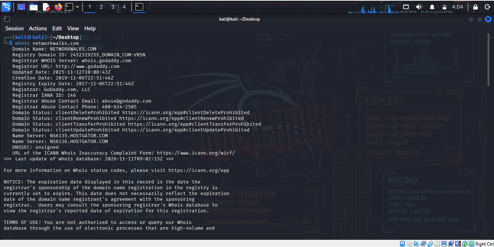
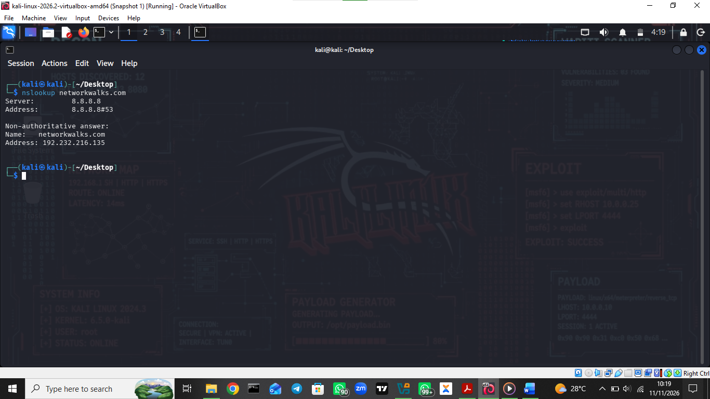
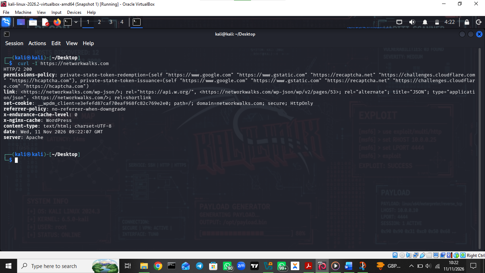
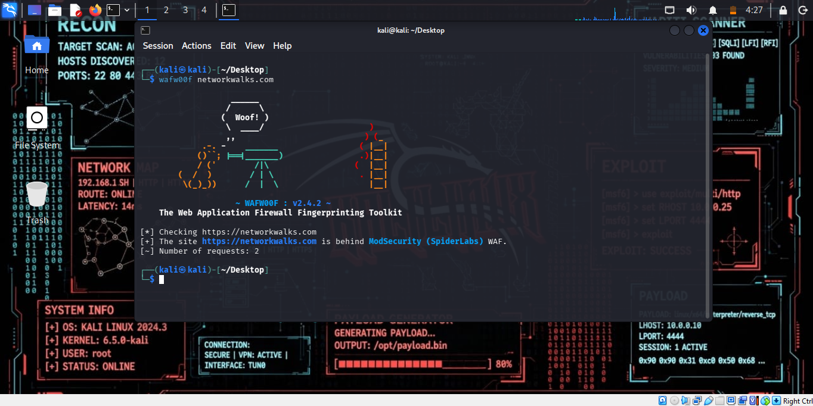
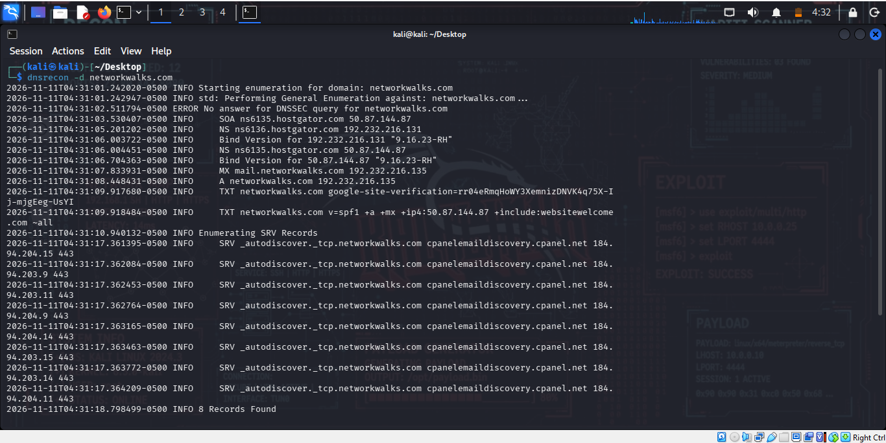
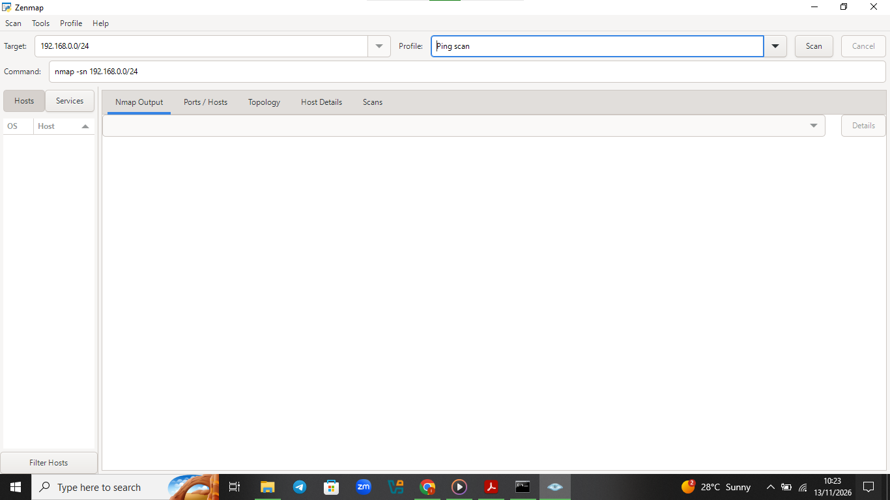

# Penetration Testing Report: Footprinting & Network Scanning

**Program:** Networkwalks B084 — Week 2  
**Module:** W2-PM-Final | Cybersecurity  
**Author:** Ibrahim Muazzam Abubakar  
**Date:** 13 November 2026  
**Modules completed:** W2-PM1 (Kali Linux tools), W2-PM5 (Zenmap scanning)  
**Phases covered:** Phase 1 — Reconnaissance and Footprinting; Phase 2 — Scanning and Network Discovery  
**Phases 3–5:** In progress

> **Before publishing:** Review all screenshots and report details for personal, client, or network-sensitive information. Redact information that is not approved for public release. The local-network examples and any crafted or illustrative values must be replaced with actual authorized results before public sharing.

## 1. Liability disclaimer

The author states that these activities were performed only on systems and devices for which written permission had been obtained or that the author owned. The material is for educational and research purposes and must be used only in a lawful and authorized context.

## 2. Introduction

This report summarizes Week 2 internship exercises covering reconnaissance of the assigned domain and network discovery on the author's own local network. The footprinting activity used Kali Linux tools to review publicly available information, while the second part focused on authorized scanning within a test environment.

The exercises demonstrate the transition from collecting publicly available information to identifying active devices within an authorized local network. The report records the tools and general observations relevant to the activities and highlights the need to interpret findings carefully.

## 3. Tools used

| Tool | Purpose |
| --- | --- |
| Kali Linux and Windows | Operating systems used for the exercises |
| WHOIS | Review publicly available domain-registration information |
| WhatWeb | Identify publicly observable web technologies |
| nslookup | Resolve a domain name through DNS |
| `curl -I` | Review HTTP response headers |
| Wafw00f | Check for indications of a web application firewall |
| DNSRecon | Review DNS record information |
| Zenmap (Nmap GUI) | Discover active hosts on an authorized local subnet and visualize topology |
| Windows Command Prompt | Check local network configuration |

## 4. Activities performed

### 4.1 Footprinting and reconnaissance

The assigned domain was reviewed using WHOIS, WhatWeb, nslookup, curl, Wafw00f, and DNSRecon. Each tool provided a different perspective:

- **WHOIS** was used to review publicly available domain-registration and nameserver information.
- **WhatWeb** identified web technologies observable from the site. Specific product/version details are intentionally not reproduced here; verify and redact these in screenshots before public release.
- **nslookup** resolved the domain to an IP address. The address is omitted from this public summary.
- **curl -I** was used to review HTTP response headers and identify publicly exposed application routes.
- **Wafw00f** reported an indication of a web application firewall. Such detection is an observation, not a validation of its effectiveness.
- **DNSRecon** was used to review publicly available DNS records, including records associated with nameservers, mail, and service configuration.

These observations describe information returned by the tools at the time of the exercise. They do not establish that a vulnerability exists.

### 4.2 Network scanning with Zenmap

Zenmap was used for network discovery on the author's own local network. The exercise involved checking the local IP configuration, selecting the authorized subnet, performing a Ping Scan, reviewing the results, and then interpreting the host list carefully.

The source notes contain illustrative host addresses and inconsistent host counts, and explicitly say that the example results must be replaced with actual results. Therefore, this report does not rely on the speculative sample values in the notes and treats the screenshots as evidence to be reviewed and corrected before broader sharing.

## 5. Risk analysis and impact

| # | Observation | Potential impact | Indicative risk |
| --- | --- | --- | --- |
| 1 | Web technology information was identifiable | Could help someone decide what software merits further security review | Medium |
| 2 | The domain resolved to an IP address | Adds to a public profile of the service's network location | Low |
| 3 | HTTP responses exposed technical details or application routes | Could assist further technology identification | Low |
| 4 | A web application firewall was detectable | Provides an indication of the security architecture, but not whether it is effective | Low |
| 5 | DNS records revealed infrastructure information | Could help build a broader profile of domain services | Medium |
| 6 | Active hosts were observable on the example local network | Unknown devices may warrant authorized inventory and verification | Medium |

Risk ratings are preliminary and based on the observations in the exercise. They are not confirmed vulnerabilities or evidence of compromise. The source notes do not include verified local-network results and should not be treated as authoritative for operational security decisions.

## 6. Recommendations

1. Review publicly visible technology information and disclose only what is operationally necessary.
2. Keep the CMS, plugins, and other software updated, and review relevant security advisories.
3. Review HTTP response headers and application routes for unnecessary information disclosure.
4. Periodically review DNS records and remove obsolete or unnecessary entries.
5. Maintain and monitor the web application firewall; assess its configuration through authorized testing.
6. Perform regular discovery on networks you own or are authorized to assess.
7. Investigate unexpected devices and maintain an up-to-date network inventory.
8. Keep network topology and device documentation current.
9. Obtain and document authorization and scope before conducting reconnaissance or scanning.
10. Redact client, personal, and internal network details from screenshots and reports before public release unless their disclosure is explicitly approved.

## 7. Conclusion

The Week 2 exercises introduced footprinting, reconnaissance, and network scanning. WHOIS, WhatWeb, nslookup, curl, Wafw00f, and DNSRecon demonstrated how different tools can reveal publicly observable information, while Zenmap showed how discovery techniques can map devices on an authorized local network.

The exercises emphasized that information gathering is an important part of security assessment, but observations must be interpreted carefully: exposed information alone does not prove a vulnerability, and scanning results must always be assessed with scope, authorization, and verification in mind.

## Evidence files

The repository contains screenshots from the exercises. Review each screenshot for sensitive information and ensure it corresponds to the final, verified report before sharing the repository publicly.

### Footprinting and reconnaissance evidence

### Network scanning evidence

